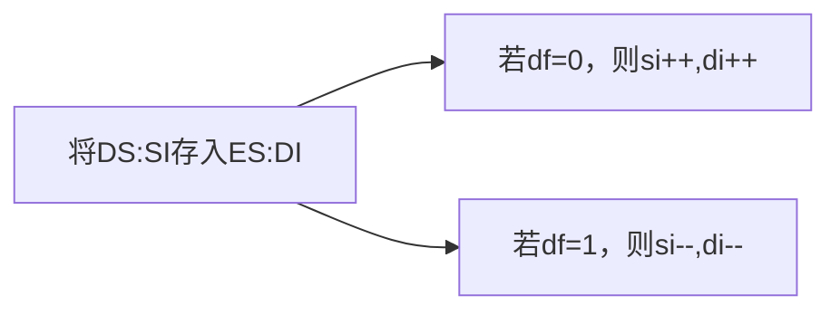
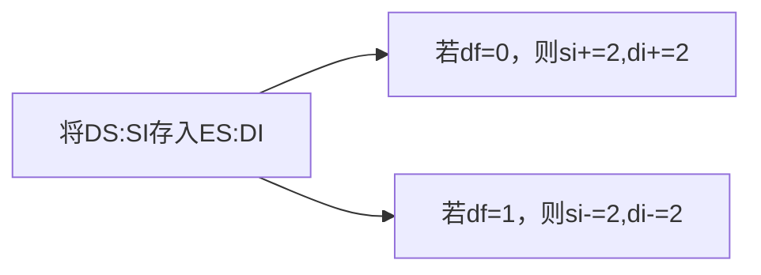

进行连续数据的传输操作

# MOVSB指令

利用[[标志寄存器#DF 标志|DF标志]]，执行`movsb`相当于



# MOVSW 指令

利用[[标志寄存器#DF 标志|DF标志]]，执行`movsb`相当于



# REP 指令

一般与`movsb/movsw`指令复合使用
```asm
rep movsb

;等价于
s:movsb
loop s

rep movsw;同理

```
