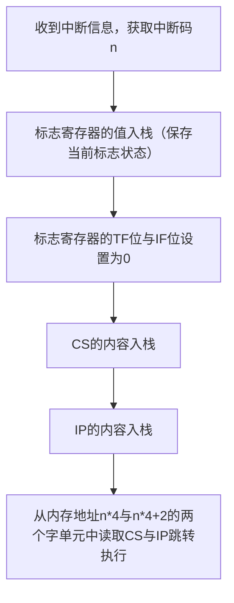
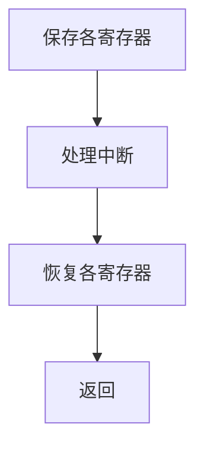
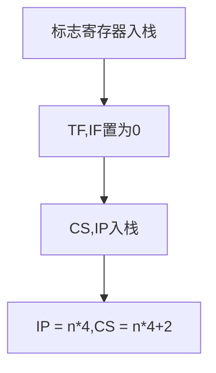

# 中断

中断是指：CPU不再接着刚才的指令向下执行，转而处理从CPU外部/内部产生的特殊信息，这个特殊信息称为中断信息。

# 中断信息的产生

当发生下面的情况时，将产生相应的中断信息：
- 除法错误（[[运算指令#DIV 指令|div指令]]产生的除法溢出）：产生中断类型0
- 单步执行：产生中断类型1
- 执行`into`指令：产生中断类型4
- 执行`int n`（n是字节型立即数）指令：产生中断类型n

# 中断向量表

中断向量表在内存中保存，存放着256个中断源对应的中断处理程序的入口
![[Pasted image 20260908152435.png]]


**规定8086CPU的中断向量存放在 0000:0000~0000:03FF**

# 中断过程




# 中断例程

中断例程用于处理中断信号，一般流程为：



## IRET 指令

执行iret指令从中断处理程序返回到主程序中。iret指令等价于

```asm
pop IP
pop CS
popf
```

## 中断例程的安装

编写完成中断例程后，我们需要设置中断向量，让中断例程能够被CPU访问执行。
那么我们需要将中断例程的地址传入对应的向量表内，

# 单步中断

CPU在完成一条指令以后，如果检测到标志寄存器的TF位为1，就会产生产生单步中断。单步中断的标志码为1。单步中断的中断例程，用于存放断点调试相关的指令（比如显示当前寄存器数据、内存数据等）。

> [!question] 为什么进入中断后TF寄存器会置为0
> 介于单步中断的机制，如果进入了单步中断，执行单步中断例程中的第一条指令时TF没有置0，那么就会再次进入单步中断，从而形成无限[[递归与动态规划#递归的一般思路|递归]]，导致程序进入死循环。


> [!warning] 响应中断的特殊情况
> 一般情况下，CPU再执行完每条指令以后，如果检测到中断信息，就会立刻响应中断。但是，存在一些特殊情况是不会响应中断的。
> 
> 例如：向ss寄存器传入数据以后，即使发生中断，CPU也不会响应。若是设置完ss后响应中断，标志寄存器以及CS:IP入栈时，此时sp还未设置，会导致相关内容无法进入栈顶。
> 
> 因此，8086CPU对修改ss寄存器的指令不响应中断。**所以在程序中，我们应当利用此特性，在设置完ss寄存器后立即设置sp寄存器。**

# INT 指令

int指令用于引发内中断，当执行 `int n` 时，流程如下


# BIOS

基本输入输出系统（Basic Input/Output System,BIOS）存放在系统板的ROM中，主要包含下面部分内容
 - 硬件系统的检测与初始化程序
 - 外中断和[[内中断]]程序
 - 用于对硬件设备进行I/O的中断程序
 - 其他和硬件系统相关的中断程序

操作系统（Operation System,OS）也提供了许多中断例程。

## DOS 提供的程序返回例程

程序结束后，需要向操作系统发生信号，释放内存。DOS就提供了`int 21h`的 `4ch` 号功能，用于程序返回

`int 21h` 的参数为 ah=功能号（此处使用4ch），al=程序返回值。

```asm
mov ah,4ch ; 调用功能4ch
mov al,0 ; 返回值0
int 21h
```

