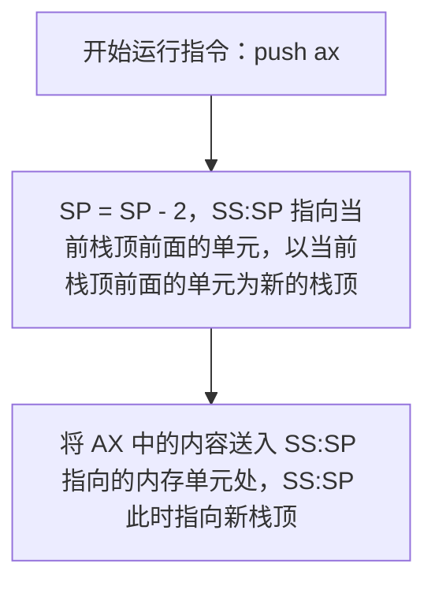
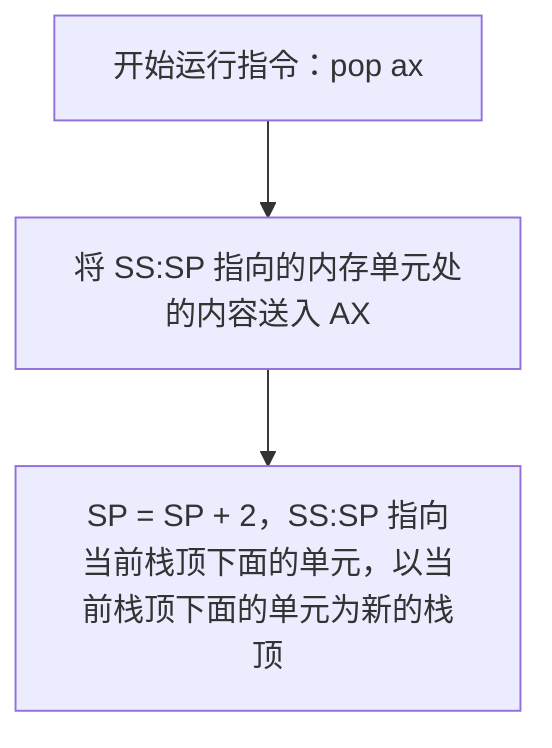

# 栈机制

8086CPU可以将一段内存当作[[栈]]进行操作，并提供了相关指令进行管理。
**一般需要暂存数据时，都使用栈来实现。**

# SS 与 SP
SS与SP都和栈操作有关，**任意时刻，SS:SP都指向栈顶内存单元**。

## PUSH 指令

![[Pasted image 20260904005259.png]]

## POP 指令

![[Pasted image 20260904105418.png]]