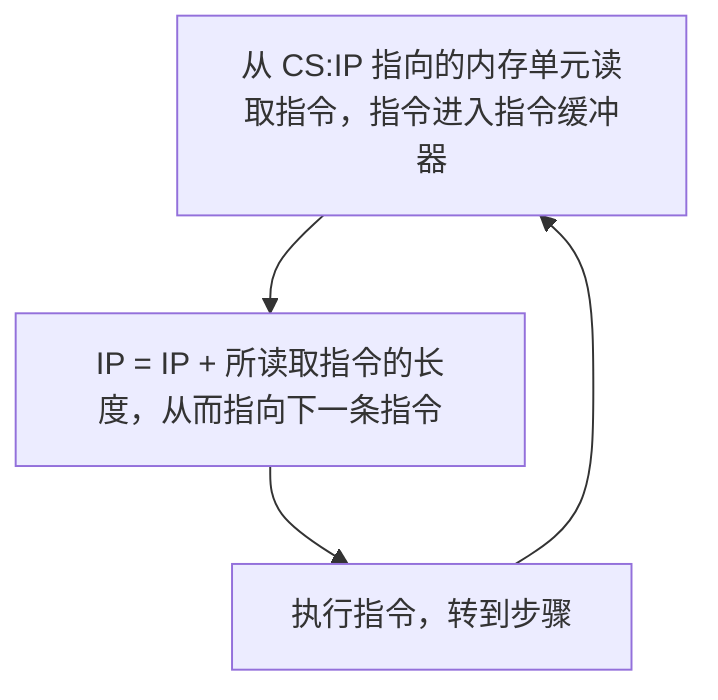

前置知识点：[[段地址与偏移地址]]
# CS与IP

**8086CPU中最关键的两个寄存器。在8086CPU运行过程中，CPU将永远将CS:IP指向内容当作指令执行。**

## 8086CPU 工作过程

> [!NOTE] CS:IP 初始值设置
> 8086CPU上电或复位后，CS被设置为`FFFFH`，IP被设置为`0000H`。即最初从`FFFF0H`单元读取指令。

## JMP 指令

修改CS、IP需要使用专用的指令，即JMP。**注意[[寄存器#MOV 指令|MOV指令]]不可以用于修改CS与IP。**
详细用法见[[转移指令#JMP 指令]]

| 指令           | 作用                                   |
| ------------ | ------------------------------------ |
| `jmp 2AE3:3` | CS=2AE3H，IP=0003H，CPU从2AE33H读取指令     |
| `jmp ax`     | 相似于`mov IP,ax`，即保持CS不变，AX寄存器内容复制到IP中 |

# 其他段寄存器

参见：
[[内存访问]]
[[栈操作]]

> [!warning] 注意
> 对于任意段寄存器，8086CPU都不允许将一个内存中的数据直接加入段寄存器中，而是需要其他寄存器的转存。

