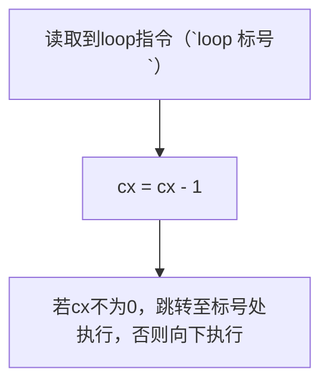

可以同时修改CS与IP的指令（段间转移），或者修改IP的指令（段内转移），统称转移指令。（参考[[段寄存器#CS与IP]]）

# OFFSET 操作符

可以取得[[伪指令#标号|标号]]的段内偏移地址，例如

```asm
assume cs:codesg
codesg segment
	start:mov ax,offset start ; 将start的偏移地址（即0）存入ax

codesg ends
end start
```

# JMP 指令

jmp 可以只修改IP，也可以同时修改CS与IP
基础用法见 [[段寄存器#JMP 指令]]

## 段内短转移

段内短转移只修改IP，同时对IP的修改范围为-128~127（8bit），格式为
```asm
jmp short 标号
```

## 段内近转移

段内近转移同样只修改IP，同时对IP的修改范围为-32768~32767（16bit），格式为
```asm
jmp near ptr 标号
```

## 段间远转移

段间远转移同时修改CS与IP，格式为
```asm
jmp far ptr 标号
```

## 地址在内存中的转移

段内转移：
```asm
jmp word ptr 内存单位地址
```

段间转移：
```asm
jmp dword ptr 内存单位地址
```

**注意：内存单位地址存放两个字，高位表示段地址，地位表示偏移地址。**


# JCXZ 指令

**有条件跳转**：若 `cx` 为0，跳转到标号处执行。jcxz是短转移，对IP的修改范围为-128~127（8bit），格式为
```asm
jcxz 标号
```


# LOOP 指令
loop指令是短转移指令，对IP修改范围为-128~127




# RET 指令

ret指令是近转移，对IP的修改范围为-32768~32767（16bit）
执行ret指令时，等价于执行`POP IP`

# RETF 指令

retf指令是段间远转移，用栈中的数据同时修改CS与IP。执行retf指令时，等价于下面操作:
```asm
pop IP
pop CS
```

# CALL 指令

call指令有多种应用格式，实现功能均不相同。
##  段内近转移

`call 标号` 等价于
```asm
push IP
jmp near ptr 标号
```

若地址存在16位寄存器中时：
`call ax`（寄存器必须为16位）等价于
```asm
push IP
jmp ax
```

若地址存在内存中时：
`call word ptr 内存单元地址` 等价于
```asm
push IP
jmp word ptr 内存单元地址
```

## 段间转移

`call far ptr 标号` 等价于
```asm
push CS
push IP
jmp far ptr 标号
```

若地址存在内存中时：
`call dword ptr 内存单元地址` 等价于
```asm
push CS
push IP
jmp dword ptr 内存单元地址
```


> [!NOTE] CALL 与 RET/RETF
> CALL 与 RET/RETF 的配合使用，可以完成函数的调用与返回
> ```asm
> assume cs:code
> code segment
> main: ;主程序
> 	...
> 	call func
> 	...
> func: ;子函数
> 	...
> 	ret
> code ends
> end main
> ```


# 条件转移指令

条件转移基于[[标志寄存器]]实现，经常配合[[运算指令#CMP 指令]]实现

| 指令       | 作用               | 含义  |
| -------- | ---------------- | --- |
| `je 标号`  | 若zf=1，跳转至标号      | 等于  |
| `jne 标号` | 若zf=0，跳转至标号      | 不等于 |
| `jb 标号`  | 若cf=1，跳转至标号      | 小于  |
| `jnb 标号` | 若cf=0，跳转至标号      | 不小于 |
| `ja 标号`  | 若cf=0且zf=0，跳转至标号 | 大于  |
| `jna 标号` | 若cf=1或zf=1，跳转至标号 | 不大于 |
