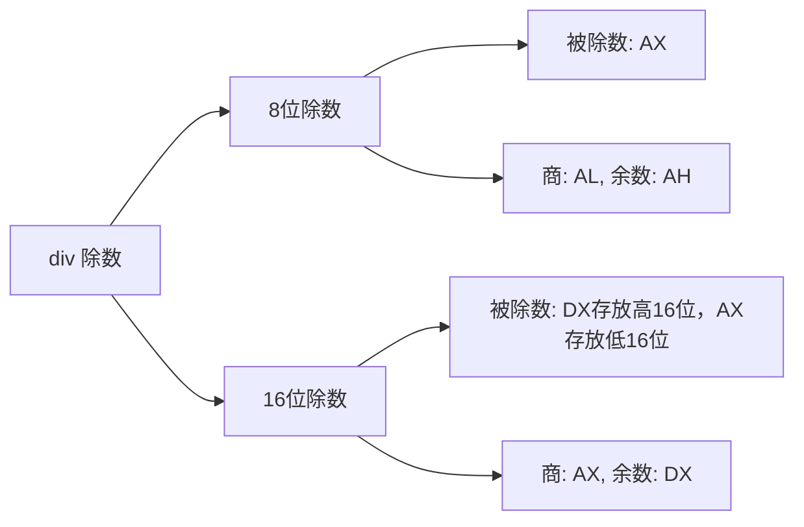
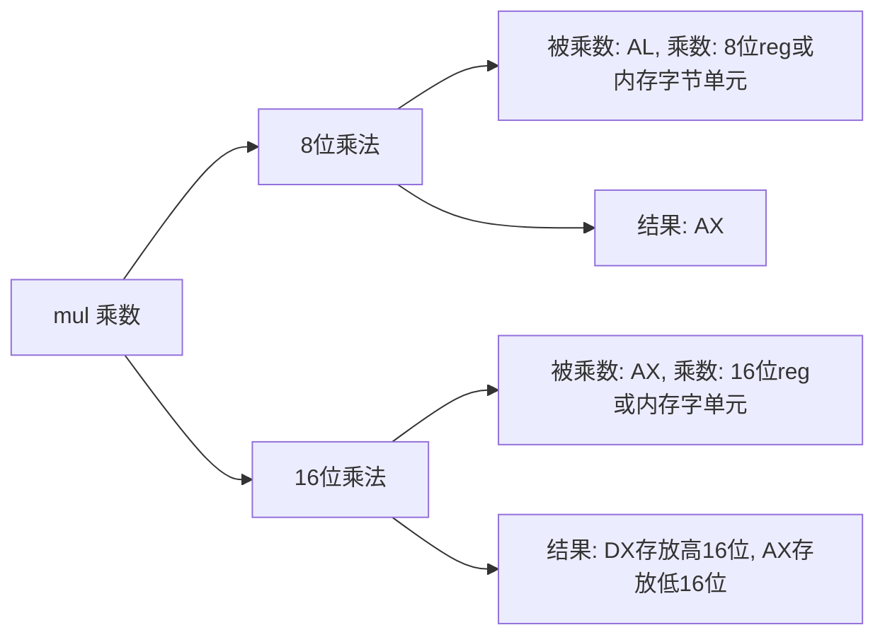

8086CPU的运算指令依靠算术逻辑单元（ALU）完成，能够将[[寄存器]]与[[内存访问|内存]]中存放的数据进行数学运算。

# ADD 指令

| 指令           | 作用               |
| ------------ | ---------------- |
| `add ax,5`   | 将立即数5加到ax中       |
| `add ax,bx`  | 将bx中数据加到ax中      |
| `add ax,[0]` | 将ds:\[0]中数据加到ax中 |

# SUB 指令

| 指令           | 作用              |
| ------------ | --------------- |
| `sub ax,5`   | 将ax减去立即数5       |
| `sub ax,bx`  | 将ax减去bx中数据      |
| `sub ax,[0]` | 将ax减去ds:\[0]中数据 |

# INC 指令

| 指令       | 作用       |
| -------- | -------- |
| `inc ax` | 将ax的值增加1 |

> [!NOTE] 注意
> `inc`指令对[[标志寄存器#CF 标志]]的内容不产生影响。

# AND 指令

| 指令             | 作用                  |
| -------------- | ------------------- |
| `and al,0123H` | 将al与0123h进行按位与并存入al |

# OR 指令

| 指令            | 作用                  |
| ------------- | ------------------- |
| `or al,0123H` | 将al与0123h进行按位或并存入al |

# DIV 指令

# MUL 指令

# ADC 指令

adc是带进位加法指令，利用CF位上记录的进位值

| 指令        | 作用             |
| --------- | ------------- |
| adc ax,bx ax = ax+bx+cf =  |

# SBB 指令

sbb是带借位减法指令，利用CF位上记录的借位值

| 指令        | 作用             |
| --------- | ------------- |
| sbb ax,bx ax = ax-bx-cf =  |

# CMP 指令

cmp是比较指令，本质是减法指令，却不存储结果，仅对[[标志寄存器]]产生影响。

当执行`cmp ax,bx`时，
- 若 $ax = bx$，则 $ax-bx=0$，故zf=1
- 若 $ax\neq bx$，则 $ax-bx\neq{0}$ ，故zf=0
- 若 $ax<bx$，则 $ax-bx$ 产生借位，故cf=1
- 若 $ax \geq bx$，则 $ax-bx$ 不产生借位，故cf=0
- 若 $ax>bx$，则 $ax-bx$ 不产生借位且结果不为0，故cf=0且zf=0
- 若 $ax \leq bx$，则 $ax-bx$ 产生借位且结果可能为0，故cf=1或zf=1